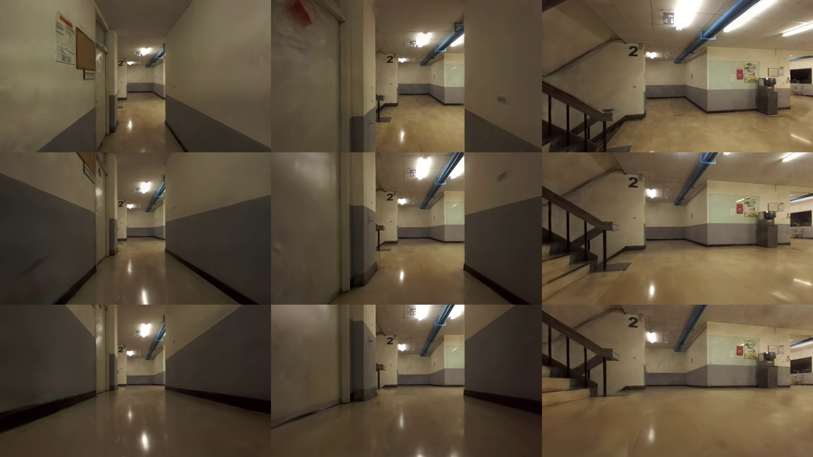
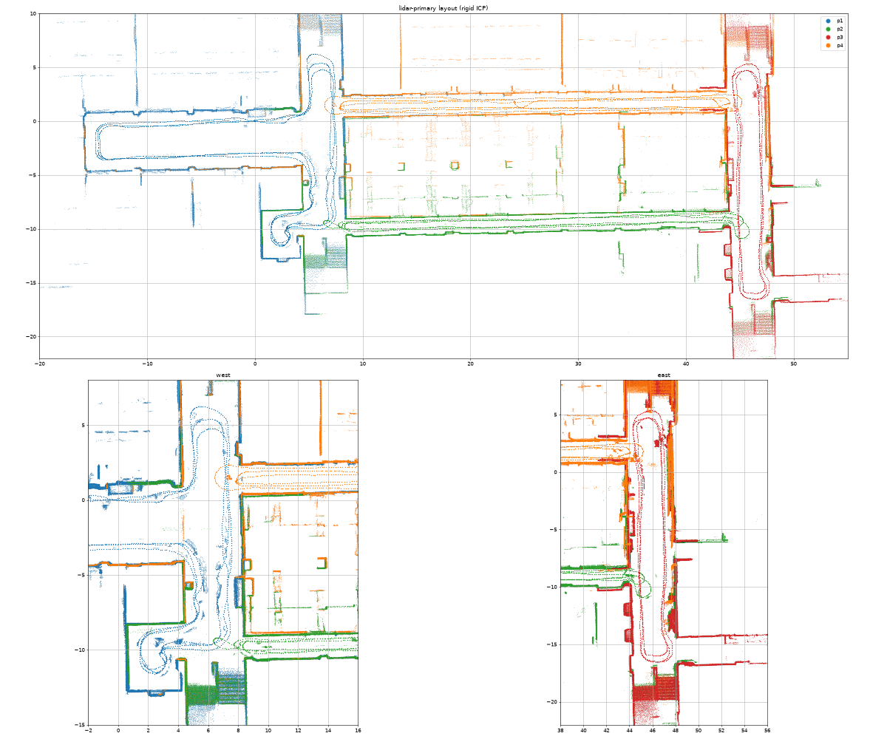
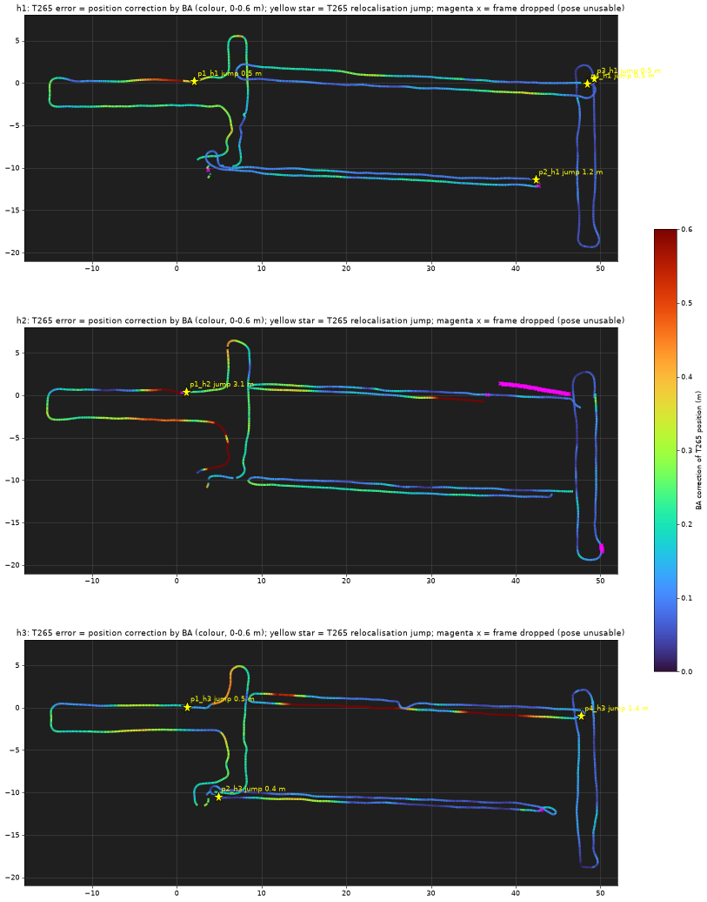
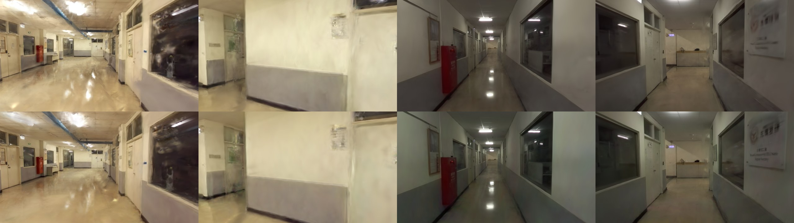
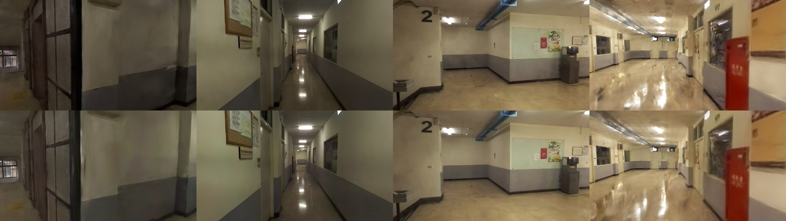
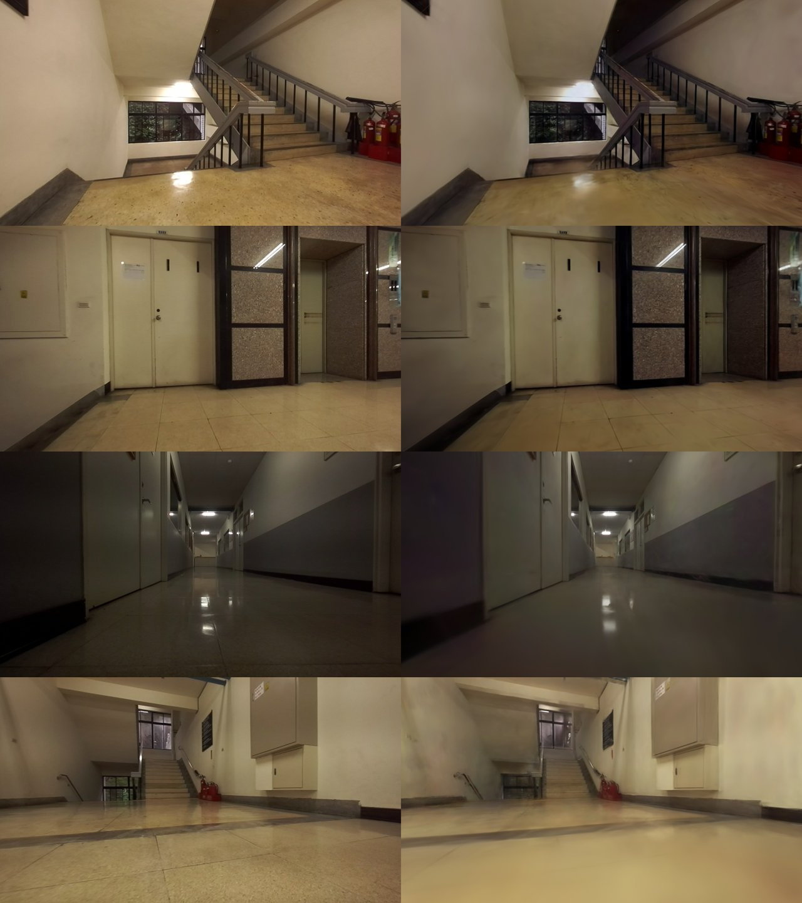
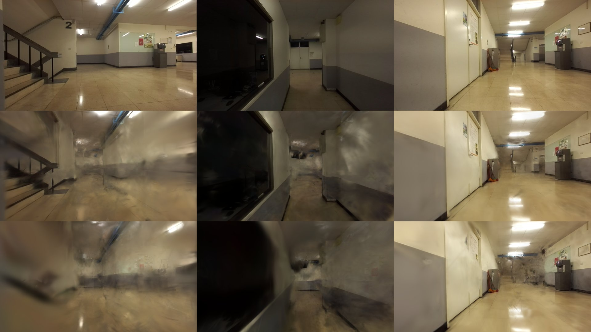

# EB 二樓整層 3D Gaussian Splatting（光達里程計 + T265 輔助）

用一台移動機器人錄的 12 段 ROS2 bag（4 個區域 × 3 個相機高度），重建整層二樓的 3D Gaussian Splatting 地圖。
**光達－慣性里程計（FAST-LIO2, Livox Mid-360）為主要位姿來源，Intel RealSense T265 為輔助**，影像來自 ZED2 左眼，訓練使用 gsplat 的 MCMC。



> **v2（2026-11-19）**：關鍵影格加密一倍、整層切成 8 個分區、每張影像的曝光補償、光達牆面約束、各分區色彩校正。
> 排除曝光差異後 PSNR 30.96 → **31.33**（兩版都沒訓練過的同一批影像：30.29 → **31.29**），細節保留率 38% → 49%。詳見[v2 改進](#v2-改進2026-11-19)。

## 下載影片與模型

影片與模型檔太大，放在 [Releases](../../releases)（最新為 **v2.0**；v1.0 為上一版）：

| 檔案 | 內容 |
|---|---|
| `floor2_3heights_front*.mp4` | 繞整層一圈，三個高度上下同步（上 h3、中 h2、下 h1）；原速 0.6 m/s、`_x1.5`、`_x2` |
| `floor2_h3_front*.mp4` | 同一路線，只有 h3 |
| `floor2_v2_compressed.ply` | v2 整層模型（1,227 萬個高斯），SuperSplat 壓縮 PLY，620 MB |
| `floor2_v2_west.ply`、`floor2_v2_east.ply` | v2 整層模型的標準 3DGS PLY，因 GitHub 單檔 2 GB 上限，以 x = 23.9 m 切成東西兩半 |

v2 影片的虛擬相機：水平視角 75°（ZED 原生約 101°，畫面邊緣都是被斜看的牆）、離牆至少 0.55 m、下傾 4°。

## 成果

在 415 張**所有分區都沒拿去訓練**的影像上評估：

| 版本 | 位姿來源 | PSNR | SSIM | LPIPS |
|---|---|---|---|---|
| 舊版 | T265 為主 + 光達合併 + COLMAP BA | 28.64 | 0.928 | 0.288 |
| **目前版本** | **FAST-LIO2 為主，T265 輔助** | **30.51** | **0.938** | **0.266** |

各區、各高度 PSNR：28.5～32.6（`results/eval_lidar_primary.json`）。

| 光達為主時的整層格局（4 區剛性 ICP，無尺度校正） | T265 誤差分布（BA 修正量，紅 = T265 偏差大） |
|---|---|
|  |  |

## v2 改進（2026-11-19）

| 項目 | 做法 | 效果 |
|---|---|---|
| 關鍵影格加密 | 每 5 cm 或 2.5° 一張（原本 12 cm／5°），共 11,187 張 | BA 重投影誤差 0.86 → 0.82 px |
| 8 個分區 | 每個區域沿走廊主軸從中位數切兩半（`scripts/make_part_map.py`） | 各分區在 300 萬高斯的上限內有更多容量 |
| 曝光補償 | 訓練時每張影像學一組 RGB 增益＋偏移，只作用於 loss（`--exposure-comp`） | 各錄影段、各高度的亮度一致，結構不再遷就曝光 |
| 光達牆面約束 | 光達平面 5 cm 體素（擴張 10 cm）內的高斯：中心拉回平面、最薄軸對齊法線、變薄（`--wall-normals`，`scripts/make_surface_normals.py`） | 牆面高斯離牆距離中位數 3.6 → 1.1 cm；只作用在光達平面附近，地板下的反光高斯不受影響 |
| 色彩校正 | 曝光補償使每個分區的整體色調可自由漂移；以 200 張實拍擬合每區增益／偏移並寫回 SH（`scripts/colour_calibrate.py`） | 分區之間色調一致、整體顏色回到實拍 |

**評估**（`scripts/eval_colourfit.py`，`results/v2_dense_8part/`）。因為 v2 刻意輸出統一曝光，直接算的 PSNR 會下降（例如 p3_h2 那段錄影本身拍得比較亮），所以另外計算「每張影像先擬合整體增益／偏移，再算 PSNR」的公平指標：

| | v1（4 分區） | v2（8 分區） |
|---|---|---|
| 排除曝光差異的 PSNR（各自的保留影像） | 30.96 | **31.33** |
| 同上，兩版都沒訓練過的同一批 45 張影像 | 30.29 | **31.29** |
| 直接 PSNR | 30.51 | 26.61 |
| LPIPS | 0.266 | 0.270 |
| 細節保留率（渲染／實拍的細尺度能量） | 38% | **49%** |

| v1（上）與 v2（下），影片路線上相同位置 |
|---|
|  |
|  |



**模糊的來源**：實拍影像的清晰度和亮度高度相關（暗的 p2、p4 只有亮的 p1 的一半），和移動速度幾乎無關，代表主因是光線不足造成的增益雜訊與相機降噪，不是動態模糊。要再明顯提升，需要重新錄影：補光、固定曝光（≤ 8–10 ms）與白平衡，並在走廊左右各走一趟，讓側牆有正面視角。

### 為什麼改成光達為主
`results/lio_vs_t265.txt`：T265 在走廊裡的路徑長度比 FAST-LIO 多 7～20%，並有多次重定位跳躍（最大 3.1 m，正好在出現「兩台飲水機」鬼影的大廳）。
FAST-LIO 在繞回起點的錄影段閉合誤差只有 3～25 cm；COLMAP BA 對光達位姿的修正中位數 3～4 cm（T265 時是 7～22 cm）。

| T265 為主的版本（大廳模糊、鬼影） | 光達為主的版本 |
|---|---|
|  |  |

## 流程

```
ROS2 bag (/livox/lidar, /livox/imu, /t265/odom, /zed/.../image/compressed, /tf_static)
 │
 ├─ FAST-LIO2 (fast_lio/run/run_fastlio.sh)              每段錄影的光達-慣性里程計 (TUM)
 ├─ 調平：路徑擬合沿走廊坡度 + 各段光達地圖的天花板平面    results/lio_trajectories/*.tum
 ├─ scripts/bag_to_colmap.py --prep_only --odom_dir      關鍵影格、相機位姿、10 s 光達子地圖
 ├─ scripts/merge_heights.py --rigid_only --planar       同一區域三個高度合併（x, y, z, yaw）
 ├─ scripts/refine_colmap.py (pycolmap 4)                SIFT + 位姿引導配對 + 帶位置先驗的 BA（含 ZED 安裝角 2.3°）
 ├─ scripts/place_layout_lio.py                          4 個區域放進同一座標系（剛性 ICP）
 ├─ scripts/build_floor2.py --strict                     整層資料集，只留 BA 修正 < 0.3 m 且 < 3° 的影像
 ├─ scripts/subset_dataset.py (VIS_R=12)                 依可見度切分區（v1：4 區；v2：PART_MAP=part_map_8.json 切 8 區）
 ├─ scripts/make_depth_dataset.py                        光達深度監督（≥1 m），移除沒有影像看過的初始點
 ├─ scripts/run_lio_train.sh / run_liod_train.sh         gsplat MCMC：每區 300 萬高斯、6 萬步、depth loss（v2 加 --exposure-comp --wall-normals）
 ├─ scripts/colour_calibrate.py                          v2：各分區色彩校正（曝光補償的整體色調）
 ├─ scripts/merge_partitions.py                          分區合併（交界 1.5 m 淡入淡出）＋評估
 └─ scripts/render_floor_video.py / make_route.py        沿錄影路線的平滑影片（三高度同步）
```

### 依賴
- ROS2 Jazzy、[FAST-LIO (ROS2 branch)](https://github.com/hku-mars/FAST_LIO) + `patches/fast_lio_ros2_jazzy.patch`（C++17、移除未使用的 pcl_ros、補 tf2_ros）
- `fast_lio/livox_ros_driver2_msgs/`：只含 `CustomMsg`/`CustomPoint` 訊息定義的 `livox_ros_driver2` 套件（不需 Livox SDK）
- [gsplat](https://github.com/nerfstudio-project/gsplat)（`patches/gsplat_base_commit.txt`）+ `patches/gsplat_simple_trainer.patch`（`--max-scale`、`--surface-grid`、`--exposure-comp`、`--wall-normals`）
- conda 環境：`gs`（torch, gsplat, open3d, mcap）與 `colmap`（pycolmap 4.x）

### 重要的訓練設定與教訓
- MCMC：`--visible-adam`、`--opacity-reg 0.001 --scale-reg 0.001`（暗走廊用預設 0.01 會崩潰）、`--no-normalize-world-space` 時 `noise_lr = 5e4·1.21/scene_scale²`、`depth_lambda = 0.05/scene_scale`
- 單一模型裝不下整層（300 萬高斯不夠）→ 4 個分區分別訓練再合併
- 不要用：bilateral grid、上限 400 萬＋packed（崩潰）、硬性光達表面約束（地板反光需要地板下的高斯，會崩潰）、合併後再刪高斯（PSNR −2 dB）
- 地板比 base_link 低約 0.2 m（ZED 在 h1 時離地約 0.23 m）

### 已知限制
只有一台朝前的相機、走廊偏暗：貼近鏡頭的側牆、近處家具（如大廳長桌）會有拖影，光滑地板的反光從錄影沒走過的位置看會糊；從走廊外或上方俯瞰時看得到模型外圍的雜亂高斯（訓練只約束「從走廊內看」的畫面）。

## 檔案
- `scripts/`：全部流程（含已不使用的實驗腳本）
- `fast_lio/`：FAST-LIO 離線執行腳本、參數、訊息套件
- `patches/`：對 FAST-LIO 與 gsplat 的修改
- `results/`：評估、光達軌跡、對齊參數
- `docs/`：圖片與渲染對照（左：實拍，右：渲染）
